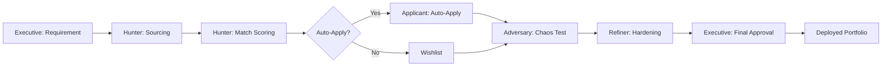

# 🎯 BountyHunter: The Agentic Career OS
**A high-performance, reference implementation for autonomous professional trajectory management.**

<p align="center">
  
</p>

[](https://www.docker.com/)
[](https://fastapi.tiangolo.com/)
[](https://playwright.dev/)
[](https://serpapi.com/)

---

## 📜 The Manifesto
**BountyHunter is not a "spray-and-pray" automation tool.** 

We believe that job searching should be a targeted operation, not a numbers game. Most AI tools flood recruiters with low-quality applications; BountyHunter does the opposite. It uses a **Council of Agents** to act as a high-fidelity filter, ensuring that only the most strategic opportunities reach your desk.

**The Core Principle:** AI evaluates, recommends, and prepares; the Human decides and acts. We provide the intelligence and the evidence, but you retain the agency.

---

## 🏗️ System Pipeline (The Enterprise Loop)
BountyHunter operates on a closed-loop governance model to ensure architectural rigor and zero-hallucination sourcing.



---

## 🛠️ Capabilities Matrix

| Agent | Role | Enterprise Capability | Outcome |
| :--- | :--- | :--- | :--- |
| **The Executive** | Project Manager | Requirements Analysis & Quality Gates | Strategic Alignment |
| **The Hunter** | Sourcing Specialist | Real-time Web-Scale Sourcing & Evidence Capture | High-Fidelity Leads |
| **The Adversary** | Chaos Engineer | Adversarial API Testing & Edge-Case Discovery | System Rigor |
| **The Refiner** | Optimization Expert | Vulnerability Patching & Performance Tuning | Hardened Infrastructure |
| **The Verifier** | Governance Auditor | Adversarial audit of every change against the Project Manifest | Verified Delivery |

---

## 📂 Project Blueprint
```text
bounty-hunter/
├── app/
│   ├── agents/             # The Council of Agents (Executive, Hunter, Adversary, etc.)
│   ├── api/                # High-performance FastAPI endpoints
│   │   └── endpoints/      # Modular route handlers for Profile, Filters, and Agents
│   ├── core/               # System configuration and environment management
│   ├── models/             # SQLAlchemy ACID-compliant data models
│   └── schemas/            # Pydantic data validation layers
├── frontend/               # Executive Suite Dashboard (Vue 3 + Tailwind, served by the API)
├── static/                 # Evidence store and brand assets (logo.svg, logo-wordmark.svg)
├── GOVERNANCE.md           # The delivery workflow every change follows
└── docker-compose.yml      # PostgreSQL + API stack
```

---

## 🚀 Quick Start Guide

### 1. Prerequisites
- Docker & Docker Compose
- A [SerpApi Key](https://serpapi.com/) (the Hunter cannot source jobs without one)

### 2. Launch Sequence
```bash
# Clone the HQ
git clone https://github.com/iconicwolf/bounty-hunter.git
cd bounty-hunter

# Configure the environment
cp .env.example .env
# Edit .env: set your database credentials and SERPAPI_KEY

# Deploy the system
docker compose up --build -d
```

Then open **http://localhost:8001**. The API serves the dashboard itself, so there is nothing to open from disk. Interactive API docs live at **http://localhost:8001/docs**.

> **Port note:** `docker-compose.yml` maps container port 8000 to host port **8001**. The dashboard calls the API on the same origin that served it, so any host or port mapping works.

### 3. Operational Flow
1. **Identity Sync**: Open the **Identity** tab and define your **Professional Persona**.
2. **Parameter Set**: In **Parameters**, configure your **Strategic Keywords** and **Target Geographies**.
3. **Deploy Hunter**: On **Portfolio**, click **Initiate Hunt**. Results are written in the background and the page refreshes itself for about a minute.
4. **Review Bounties**: Analyze high-match roles, their match score, and their visual evidence. **History** lists everything that has moved past the Wishlist.

---

## 🔌 API Reference
All routes are served from the same origin as the dashboard. Note the trailing slashes on collection routes.

| Method | Route | Purpose |
| :--- | :--- | :--- |
| `GET` / `POST` | `/profile/` | Read or create/update your professional profile (`404` until first saved) |
| `GET` / `POST` | `/filters/` | Read (auto-created with defaults) or update hunting parameters |
| `GET` / `POST` | `/applications/` | List or create tracked opportunities (includes `match_score`) |
| `DELETE` | `/applications/{id}` | Remove an opportunity |
| `POST` | `/agents/hunter/search` | Start a background sourcing cycle |
| `POST` | `/agents/executive/orchestrate?requirement=...` | Run the Enterprise Loop for a requirement |
| `POST` | `/agents/verifier/audit` | Audit a proposed change against the project manifest |

> **Routing rule:** the dashboard is mounted at `/` in `app/main.py`, and that mount matches every path. It **must be registered after** all API routers, or the API becomes unreachable (`404`/`405`).

---

## 🧑‍💻 Local Development (without Docker)
You still need a PostgreSQL instance, configured through the `DB_*` variables in `.env`.
```bash
python -m venv venv && source venv/bin/activate
pip install -r requirements.txt
playwright install chromium        # used by Evidence Capture
uvicorn app.main:app --reload --port 8001
pytest                             # run the test suite
```

---

## 🛠️ Troubleshooting
| Symptom | Likely cause |
| :--- | :--- |
| Toasts say "Method Not Allowed" / empty portfolio | API routes are shadowed by the `/` mount; see the routing rule above |
| Dashboard loads but cannot save | The API is not reachable from your browser (check the port mapping and container logs) |
| Hunt starts but no jobs appear | Missing or invalid `SERPAPI_KEY`; check the app container logs |
| `GET /profile/` returns 404 on a fresh install | Expected; save your profile in the Identity tab first |

---

## 🔐 Security
- Never commit real secrets. `.env` holds credentials and API keys; it is git-ignored, so commit only `.env.example`.
- `.env` was tracked in earlier commits. Treat any real key that was ever in it as exposed and **rotate it**: untracking the file does not erase it from git history.

---

## 💰 Running on a Budget
BountyHunter is designed to be resource-efficient.
- **SerpApi**: Use the free tier for initial testing (100 searches/month).
- **Docker**: The system uses a lightweight PostgreSQL image to minimize RAM usage.
- **Localhost**: The entire suite runs locally, ensuring your professional data never leaves your machine except for the API calls to search providers.

---

## 🎓 Learning Center
This project serves as a reference implementation for **Agentic Governance**.
- **[GOVERNANCE.md](GOVERNANCE.md)**: The delivery workflow and "Zero Trust" policy every change must pass, including how the Executive/Council hierarchy guards against hallucinated results.
